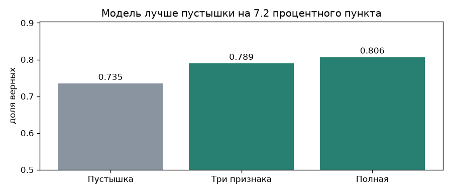

# Отток клиентов Telco

Цель — предсказать уход клиента до его решения о расторжении договора. Одна строка соответствует одному клиенту. Использован учебный набор [IBM Telco Customer Churn](https://raw.githubusercontent.com/IBM/telco-customer-churn-on-icp4d/master/data/Telco-Customer-Churn.csv). Класс 1 означает уход.

## Данные и журнал решений

- Churn: No → 0, Yes → 1; исходный raw не изменяем
- Полных дублей и повторов ID нет; точные повторы удаляем, конфликтующие ID не удаляем автоматически
- Проверены tenure ≥ 0, MonthlyCharges > 0, TotalCharges ≥ 0 и SeniorCitizen ∈ {0,1}; нарушений нет
- 11 пустых TotalCharges — пропуски; No internet service / No phone service — смысловые категории, не NaN
- 11 пустых TotalCharges у клиентов с tenure=0: сохранён флаг; 0 — допущение для новых клиентов, а не подтверждённая сумма
- TotalCharges преобразован из строки в число; цель — целые 0/1
- IQR: кандидатов в tenure, MonthlyCharges, TotalCharges нет; допустимые крайние значения оставлены, log1p показан для сравнения
- Функция clean воспроизводит пошаговую очистку; проверки пройдены

## Наблюдения и выводы

- Из 7043 клиентов ушли 1869 (26,54%).
- При помесячном контракте доля ухода 42,71%, при двухлетнем — 2,83%.
- На test accuracy модели 79.84%, выигрыш над пустышкой 6.39 п.п.
- Модель выявила 51.07% ушедших. Следующая проверка — на клиентах более позднего периода.

## Признаки и утечка

Модель учитывает число дополнительных услуг, первый год обслуживания и автоматическую оплату. Уникальный номер и целевая метка исключены из входов. Для накопленного платежа дата доступности неизвестна. Accuracy на обучающих фолдах без этого поля и флага пропуска составила 80.64%, с ними 80.69%. Рабочая модель использует только признаки, доступные на момент прогноза.

## Сравнение моделей

Стратифицированное деление 80/20. На train подготовка обучалась заново в каждом из пяти фолдов. Варианты порога редкости и регуляризации сравнивались по accuracy. Отложенная выборка использована после выбора настроек.

| Модель | CV accuracy | Test accuracy |
|---|---:|---:|
| Пустышка | 73.46% | 73.46% |
| Три признака | 78.93% | — |
| Полная | 80.64% | 79.84% |

## Как запустить

Из корня проекта выполните `python -m pip install -r requirements.txt`, затем откройте `project.ipynb` в Jupyter и выполните все ячейки. Исходный CSV находится в `project_data/raw.csv`, очищенный — в `data/telco_clean.csv`. Модель загружается из корня проекта командой `joblib.load("model/telco.joblib")` после `import joblib`. Модуль `features.py` нужен для загрузки и построения признаков.
